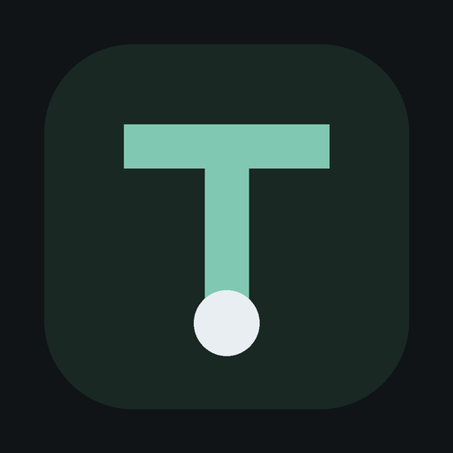
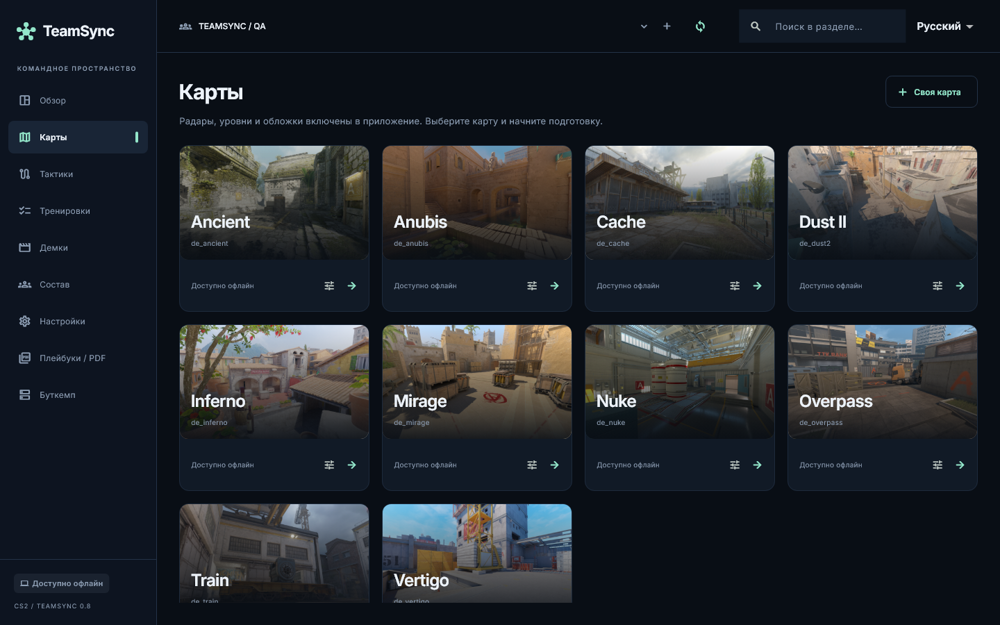

<p align="center"></p>
<h1 align="center">TeamSync</h1>
<p align="center">Общая тактическая комната для команды CS2.<br>Native Windows & Android · Русский / English</p>
<p align="center">
  <a href="https://github.com/BrainMcLore/teamsync/actions/workflows/windows-release.yml"></a>
  <a href="https://github.com/BrainMcLore/teamsync/actions/workflows/android.yml"></a>
</p>

Рисуйте выходы на готовых картах, разбирайте раунды, распределяйте задания и собирайте печатные плейбуки. TeamSync устанавливается на компьютер и телефон. Интерфейс работает на Flutter; веб-клиента нет. Linux используется для разработки.



**Проект в разработке.** Последний опубликованный установщик — [Windows 0.8.0](https://github.com/BrainMcLore/teamsync/releases/tag/v0.8.0). Изменения в `main` могут опережать релиз. Android проходит отдельную сборку и проверку на эмуляторе; тестовый APK не является магазинным выпуском. Полная приёмка исходного ТЗ ещё не завершена.

| Возможность | Windows | Android |
| --- | --- | --- |
| Steam / Discord, аккаунты, приглашения и состав | Да | Да |
| Общие тактики, заметки, история и очередь изменений | Да | Да |
| Готовые карты, Cache, T/CT, гранаты, этажи | Да | Да |
| Командные задания и назначение по аккаунтам | В `main` | В `main` |
| Раскидки, свои изображения/MP4, инструкции и проверка изучения | В `main` | В `main` |
| Импорт DEM / ZIP / RAR и каталог HLTV | Да | Подготовленные разборы с ПК |
| 2D-разбор и заметки к конкретным тикам | Да | Да |
| PDF-плейбуки со снимками тактик | Да | Да |
| Запуск демки в CS2, локальные CS2 / TeamSpeak | Да, нужна игровая приёмка | Управление сервером с телефона не выпущено |

**Общая работа.** Команда создаётся в онлайн-аккаунте. Приглашайте игроков по ID аккаунта, назначайте роли и открывайте общую библиотеку. Изменения тактик отправляются автоматически; при потере сети сохраняются в очереди. Сервер повторно проверяет доступ при отправке. Конкурирующие изменения сохраняются отдельными копиями. Локальный кеш разделён по серверу и пользователю; отдельные офлайн-аккаунты не создаются.

**Демки.** Windows-компаньон скачивает архивы, распаковывает их и разбирает реальные события и позиции вне UI. HLTV может потребовать проверку в изолированном окне WebView2. На Android переносится подготовленный `.teamsync-review`; тяжёлый DEM-парсер остаётся на ПК. Заметки привязаны к раунду и тику. Запуск в CS2 выполняется через установленный Steam.

**Буткемп.** Загрузка CS2 Dedicated Server через официальный SteamCMD, TeamSpeak и установка закреплённых версий серверных плагинов доступны в Windows. Лицензия TeamSpeak принимается пользователем. Полная установка CS2 и матч с реальными игроками ещё требуют проверки.

В текущих исходниках задания проходят этапы «К выполнению → В процессе → На проверке → Подтверждено». Возврат требует комментария тренера; история сохраняет авторов и время, последние загруженные записи доступны без сети. Тип тренировки, срок и критерий выполнения задаются в форме задания. Доказательства выполнения, отдельные комментарии, шаблоны и мастер планирования ещё в разработке.

### Начать работу

1. Установите Windows-сборку из [Releases](https://github.com/BrainMcLore/teamsync/releases). Сверьте SHA-256 с приложенным файлом контрольных сумм.
2. Войдите через Steam или Discord. В сборке указан общий API; собственный HTTPS-сервер можно задать в настройках аккаунта.
3. Создайте команду, пригласите игроков и откройте общую библиотеку.
4. Выберите карту, создайте тактику и дождитесь подтверждения синхронизации.

Пользовательские материалы хранятся в системном каталоге приложения, путь доступен в настройках. Перед обновлением и экспериментами с данными сохраняйте резервную копию. Инструкция: [USER_GUIDE.md](USER_GUIDE.md).

### Разработка

Закреплённый инструмент: **Flutter 3.47.8 / Dart 3.13.7**. Python-компаньон собирается на Python 3.10; backend проверяется на Python 3.12. Зависимости фиксируются в `pubspec.lock` и `requirements*.txt`.

```bash
cd client
flutter pub get
flutter analyze
flutter test
```

Windows: Visual Studio 2022 с C++ workload и Windows SDK, Python 3.10, Inno Setup. Из PowerShell в корне проекта:

```powershell
./tools/build-demo-worker.ps1
./tools/build-windows.ps1 -Installer
```

Android: JDK 17, Android SDK и Flutter. Сборка из `client`:

```bash
flutter build apk --release \
  --dart-define=TEAMSYNC_API_URL=https://teamsync-api-ui7n.onrender.com
```

Без переменных подписи Gradle собирает тестовый APK. В CI для основной ветки настроен отдельный постоянный ключ; сертификат сверяется с `packaging/android-signing.sha256`. Keystore и пароль хранятся в закрытых Actions secrets и не входят в Git. Переход с прежнего тестового APK на другую подпись требует предварительного экспорта материалов и переустановки; обновление поверх старой тестовой подписи невозможно. [Android CI](.github/workflows/android.yml) проверяет аккаунты и командные операции на Android 15, затем собирает APK и проверяет подпись. Windows собирается отдельно на Windows runner.

```bash
python -m venv .venv
# Активируйте окружение подходящей для своей ОС командой.
python -m pip install -r server/requirements.txt
python -m pytest server/tests -q
python -m unittest discover -s tools -p test_release.py -v
```

### Устройство проекта

| Каталог | Содержимое |
| --- | --- |
| `client/` | Flutter, SQLite, RU/EN, редактор, разбор, PDF |
| `server/` | FastAPI, PostgreSQL, OAuth, роли и версионируемые документы |
| `worker/` | Загрузки, безопасная распаковка и парсинг CS2 |
| `native/` | Windows-компонент загрузки WebView2 |
| `tools/`, `packaging/` | Проверки, воспроизводимые архивы и установщики |

[Проверки](CHECKS.md) · [План](ROADMAP.md) · [Архитектура](ARCHITECTURE.md) · [Сервер](FREE_HOSTING.md) · [Релизы](RELEASE.md) · [Исходное ТЗ](TeamSync_requirements_RU_EN.md)

### English

TeamSync is a native CS2 team workspace for Windows and Android, with Russian and English interfaces. Plan tactics on bundled maps, share drawings and notes with your roster, review prepared demos and export printable playbooks. Windows handles DEM parsing, HLTV downloads and local game servers. Own MP4 clips and aiming images are shared as protected team attachments; external videos remain links. Android opens prepared reviews and the shared tactical library.

This is an active development project. The published Windows release and the current source branch have different verification scopes; see the feature table and linked checks before deploying. Local builds without signing variables use a test key; main-branch CI uses a persistent release key and verifies its public certificate fingerprint. Linux is a development environment, not an application target.

### Сторонние материалы

TeamSync не связан с Valve, HLTV или TeamSpeak. Карты и изображения принадлежат их правообладателям; происхождение, закреплённая ревизия и контрольные суммы указаны в [манифесте карт](client/assets/maps/manifest.json). Лицензии шрифтов находятся рядом с файлами в `client/assets/fonts/`. Внешние источники могут менять доступность; скачивание материалов не предоставляет права на их перераспространение.
