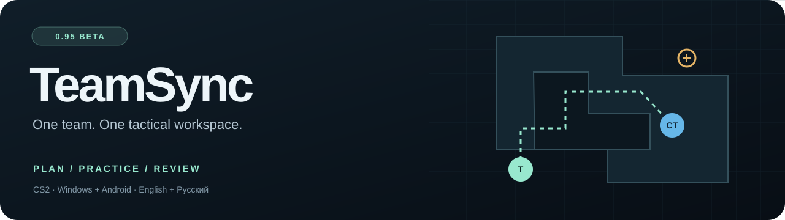
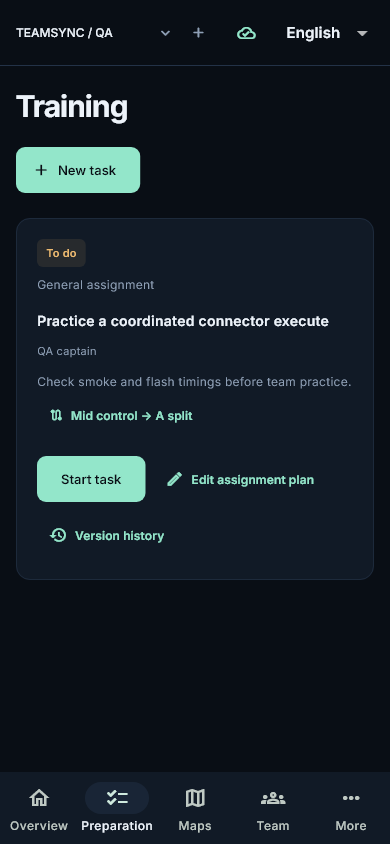
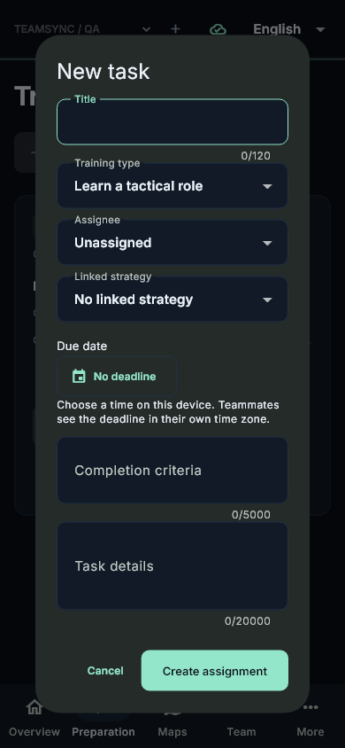
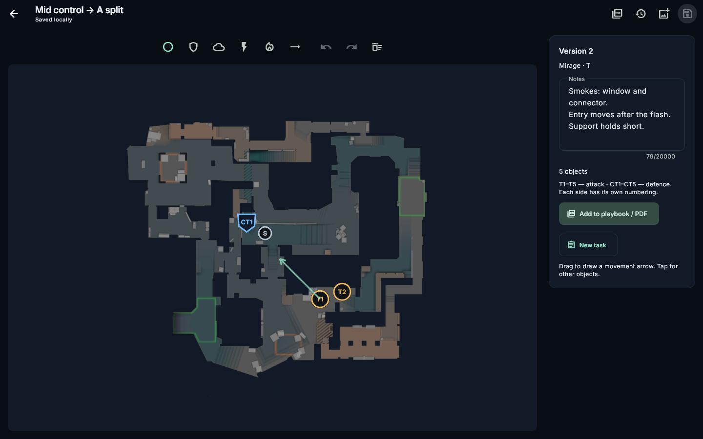
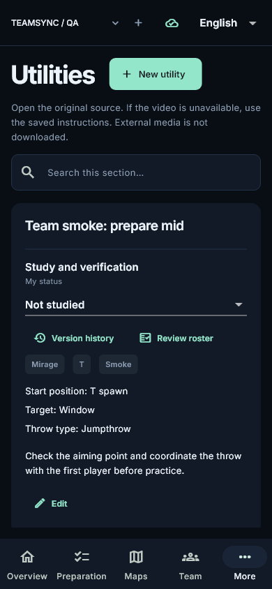

<p align="center"><a href="README.md"><b>English</b></a> · <a href="README.ru.md">Русский</a></p>



<p align="center">
<a href="https://github.com/BrainMcLore/teamsync/releases/tag/v0.95.0-beta"></a>
<a href="https://github.com/BrainMcLore/teamsync/actions/workflows/windows-release.yml"></a>
<a href="https://github.com/BrainMcLore/teamsync/actions/workflows/android.yml"></a>

</p>

**Your team's CS2 preparation, in one place.** Draw tactics on ready-to-use maps, share utility lineups, assign personal practice plans, review demos and print LAN playbooks. TeamSync is an installable **Windows and Android application**, with English and Russian interfaces.

<p align="center">
<a href="https://github.com/BrainMcLore/teamsync/releases/download/v0.95.0-beta/TeamSync-0.95.0-beta-Windows-Setup.exe"></a>
<a href="https://github.com/BrainMcLore/teamsync/releases/download/v0.95.0-beta/TeamSync-0.95.0-beta-Android.apk"></a>
</p>

<p align="center"><a href="https://github.com/BrainMcLore/teamsync/releases/tag/v0.95.0-beta">Release notes & checksums</a> · <a href="docs/user-guide.md">User guide</a> · <a href="docs/development.md">Build from source</a></p>

## A shared tactical room


| Plan | Practice | Review |
| --- | --- | --- |
| Ready map library, including Cache and multi-level radars | Training types, deadlines and completion criteria | Demo library and native 2D review |
| T/CT players, utility, arrows, notes and version history | Map-preparation wizard with per-tactic player assignments | Notes attached to ticks and rounds |
| Team utility library with your own images and MP4 clips | Four templates: role study, dry run, execute and retake | PDF playbooks with tactic snapshots |

**Built for a team.** Sign in through Steam or Discord, invite player accounts and choose roles. Tactics, maps, utility materials and assignments share a versioned team library. Saved changes queue on the device while disconnected; conflicts preserve a copy instead of silently replacing your work.

## From a tactic to a personal plan

Open a map → select tactics and players → choose a template and deadline → distribute assignments → review submitted work.

<p align="center">


</p>

Assignments move through **Assigned → In progress → Submitted → Approved**. Returning work requires a comment. History records the author and time; previously loaded history remains available offline. Deadlines appear in each device's local time.

<details>
<summary><b>See the tactic editor and utility library</b></summary>


<p align="center"></p>
</details>

## Windows and Android

| Feature | Windows | Android |
| --- | --- | --- |
| Team accounts, invitations, roles and shared tactics | ✓ | ✓ |
| Utility images/clips, training plans and PDF playbooks | ✓ | ✓ |
| 2D demo review and tick-linked notes | ✓ | Prepared reviews imported from PC |
| DEM / ZIP / RAR parsing and HLTV catalog | ✓ | Prepared reviews |
| Open a demo in CS2 | ✓ — requires CS2 | — |
| Local CS2 / TeamSpeak installation and bootcamp controls | ✓ | Remote server control is not released |

## Get started

1. Install the Windows package or Android APK from **[0.95 Beta](https://github.com/BrainMcLore/teamsync/releases/tag/v0.95.0-beta)**.
2. Sign in, create a team or accept an invitation, and open its shared library.
3. Pick a map, save a tactic and wait for the sync confirmation.
4. Use **Prepare map** to turn tactics into assigned training plans.

Release assets include SHA-256 checksums. Android releases use a persistent signing key; installing over an older build signed with a different test key requires a backup and reinstall. Export your materials before changing installations.

## Beta scope

**0.95 is a beta**, with working Windows/Android builds and automated client, API, parser and Android integration checks. It is not a claim that every planned feature is finished.

- HLTV/CDN access can require a verification window or change availability. External source links open the original; third-party videos are not copied for offline use.
- Training evidence, independent comments, scheduling, push notifications and live joint review remain planned.
- Remote server-agent control and complete offline review/history bundles remain planned.
- Steam account linking, real CS2 playback, live PUG/TeamSpeak sessions and physical-device scenarios still need broader acceptance.
- Hosted service limits and cold starts apply. [Self-hosting](docs/deployment.md) is supported; provider pricing and availability are not guaranteed.

See the [roadmap](docs/roadmap.md), [verification scope](docs/verification.md) and [acceptance checklist](docs/acceptance.md).

## Build & explore

**Flutter 3.47.8 · Dart 3.13.7 · JDK 17 · Python 3.10/3.12**

```sh
cd client
flutter pub get
flutter analyze
flutter test
```

Windows builds require the Windows C++ toolchain and Inno Setup. Android builds require the Android SDK. Linux can be used for development and tests; it is not an application target. See the complete [development guide](docs/development.md).

| Directory | Contents |
| --- | --- |
| `client/` | Native Flutter app, SQLite, localization and tests |
| `server/` | API, identity, teams, media and versioned documents |
| `worker/`, `native/` | Windows demo parser/download companion |
| `docs/` | User, developer and self-hosting documentation |
| `tools/`, `packaging/`, `.github/` | Builds, release packaging and CI |

## Third-party materials

TeamSync is not affiliated with Valve, HLTV or TeamSpeak. Maps, radars and other third-party materials retain their respective ownership and licenses. Sources and pinned revisions are recorded in the [map attribution](client/assets/maps/ATTRIBUTION.txt) and [manifest](client/assets/maps/manifest.json); font and bundled-component licenses remain with their files. A public repository does not grant additional rights to third-party media.
