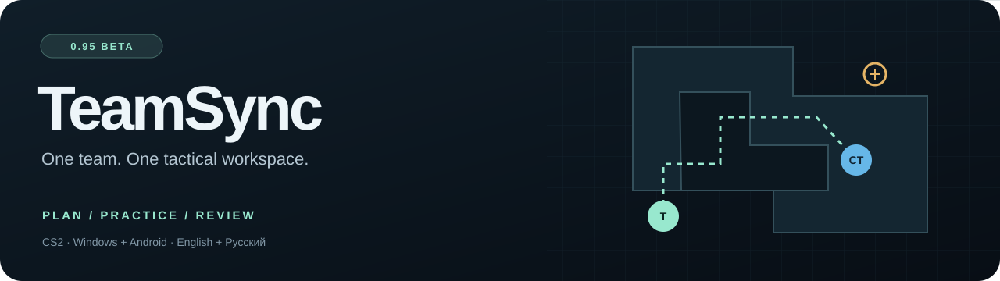
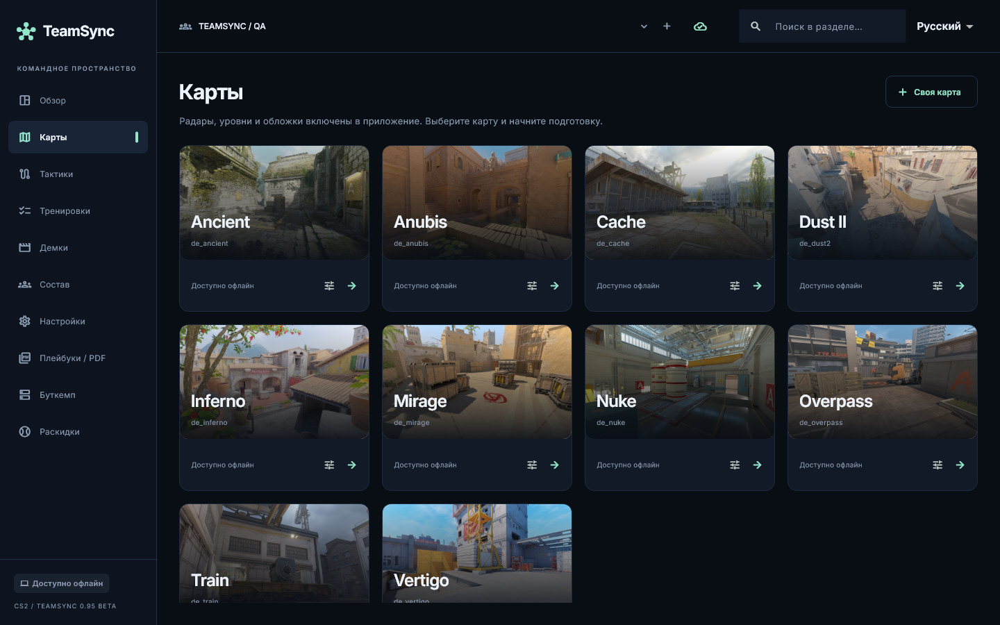
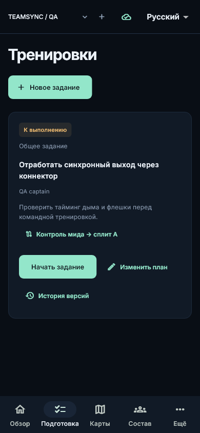
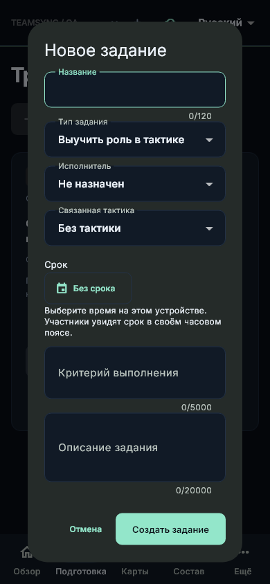
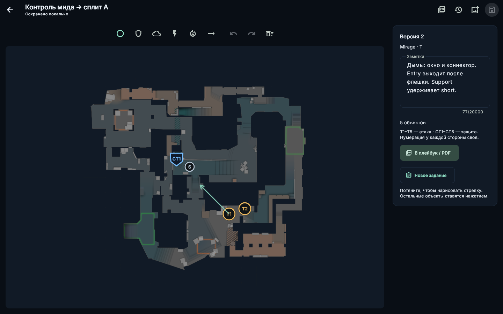
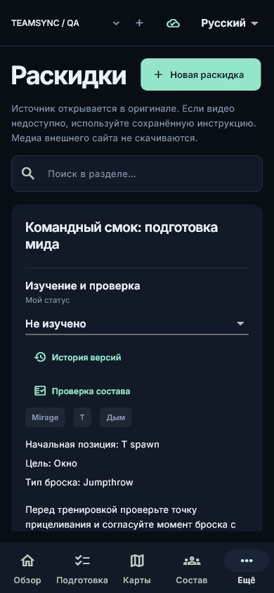

<p align="center"><a href="README.md">English</a> · <a href="README.ru.md"><b>Русский</b></a></p>



<p align="center"><a href="https://github.com/BrainMcLore/teamsync/releases/tag/v0.95.0-beta"></a> </p>

**Подготовка вашей команды в CS2 — в одном приложении.** Создавайте тактики на готовых картах, собирайте раскидки, назначайте тренировки игрокам, разбирайте демки и печатайте заготовки раундов. Устанавливаемое приложение для **Windows и Android**, с русским и английским интерфейсом.

<p align="center"><a href="https://github.com/BrainMcLore/teamsync/releases/download/v0.95.0-beta/TeamSync-0.95.0-beta-Windows-Setup.exe"><b>⬇ Windows x64</b></a>　·　<a href="https://github.com/BrainMcLore/teamsync/releases/download/v0.95.0-beta/TeamSync-0.95.0-beta-Android.apk"><b>⬇ Android APK</b></a>　·　<a href="https://github.com/BrainMcLore/teamsync/releases/tag/v0.95.0-beta">Состав релиза и SHA-256</a></p>

## Общая тактическая комната



| Планирование | Тренировки | Разбор |
| --- | --- | --- |
| Готовые карты, включая Cache и многоуровневые радары | Тип задания, срок и критерии выполнения | Библиотека демок и нативный 2D-просмотр |
| Игроки T/CT, гранаты, стрелки и история версий | Мастер подготовки карты с распределением игроков по тактикам | Заметки к тикам и раундам |
| Общие раскидки со своими изображениями и MP4 | Шаблоны изучения роли, dry run, выхода и ретейка | PDF-заготовки со снимками тактик |

**Тактики принадлежат команде.** Вход через Steam или Discord, приглашения аккаунтов и роли участников. Карты, тактики, раскидки и задания синхронизируются через общую библиотеку с версиями. Без связи изменения остаются в очереди на устройстве; при конфликте сохраняется копия.

## От тактики к персональному плану

Откройте карту → выберите тактики и игроков → задайте шаблон и срок → распределите задания → проверьте выполненное.

<p align="center"></p>

Статусы: **Назначено → В работе → На проверке → Принято**. Возврат требует комментария. История содержит автора и время изменений; загруженная история доступна без связи. Сроки отображаются в часовом поясе устройства.

<details><summary><b>Редактор тактик и библиотека раскидок</b></summary>


<p align="center"></p>
</details>

## Возможности платформ

| Возможность | Windows | Android |
| --- | --- | --- |
| Аккаунты, состав, роли и общие тактики | ✓ | ✓ |
| Свои изображения/клипы, планы тренировок, PDF | ✓ | ✓ |
| 2D-разбор и заметки к тикам | ✓ | Импорт подготовленного разбора с ПК |
| Разбор DEM / ZIP / RAR и каталог HLTV | ✓ | Подготовленные разборы |
| Запуск демки в CS2 | ✓ — нужна установленная CS2 | — |
| Установка локальных CS2 / TeamSpeak и буткемп | ✓ | Удалённое управление сервером пока не выпущено |

## Начало работы

1. Установите [0.95 Beta](https://github.com/BrainMcLore/teamsync/releases/tag/v0.95.0-beta) для своей платформы.
2. Войдите в аккаунт, создайте команду или примите приглашение.
3. Сохраните тактику и дождитесь подтверждения синхронизации.
4. Через подготовку карты создайте персональные задания игрокам.

APK подписан постоянным ключом. Для перехода с прежней тестовой сборки с другой подписью может понадобиться резервная копия и переустановка. Перед сменой установки экспортируйте свои материалы.

## Что означает Beta

0.95 — рабочая бета, а не заявление о завершении всех запланированных функций.

- Доступ к HLTV/CDN может требовать окна проверки. Ссылки на стороннее видео открывают оригинал; такие видео не копируются для офлайн-просмотра.
- Доказательства выполнения, отдельные комментарии, расписание, push-уведомления и совместный живой разбор остаются в планах.
- Серверный агент и полные офлайн-пакеты истории/разборов ещё не выпущены.
- Вход Steam, запуск CS2, реальные PUG/TeamSpeak-сессии и физические устройства требуют более широкой проверки.
- У облачного сервиса есть ограничения и холодные старты. Доступно [самостоятельное размещение](docs/deployment.md); неизменность условий провайдеров не гарантируется.

[Руководство](docs/user-guide.md) · [Проверки](docs/verification.md) · [Приёмка](docs/acceptance.md) · [Планы](docs/roadmap.md)

## Разработка

Flutter 3.47.8 · Dart 3.13.7 · JDK 17 · Python 3.10/3.12.

```sh
cd client
flutter pub get
flutter analyze
flutter test
```

Для Windows нужны C++ toolchain и Inno Setup, для Android — Android SDK. Linux используется как среда разработки, а не целевая платформа приложения. [Инструкция сборки](docs/development.md).

| Каталог | Содержимое |
| --- | --- |
| `client/` | Flutter, SQLite, локализация, тесты |
| `server/` | API, аккаунты, команды, медиа и версии документов |
| `worker/`, `native/` | Разбор демок и Windows-загрузчик |
| `docs/` | Документация и изображения |
| `tools/`, `packaging/`, `.github/` | Сборка, упаковка и CI |

## Сторонние материалы

TeamSync не связан с Valve, HLTV или TeamSpeak. Права на карты, радары и другие сторонние материалы принадлежат их владельцам. Источники закреплены в [атрибуции карт](client/assets/maps/ATTRIBUTION.txt) и [манифесте](client/assets/maps/manifest.json). Лицензии шрифтов и компонентов сохранены рядом с файлами. Публичность репозитория не предоставляет дополнительных прав на сторонние материалы.
